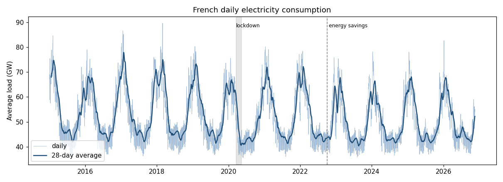
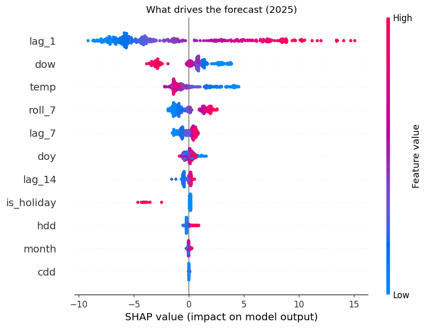
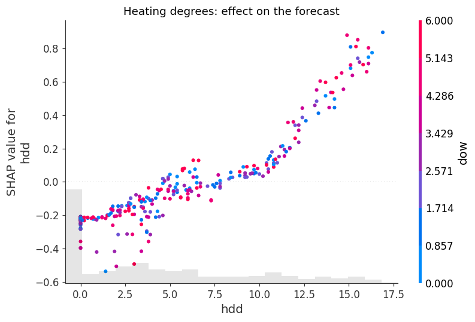
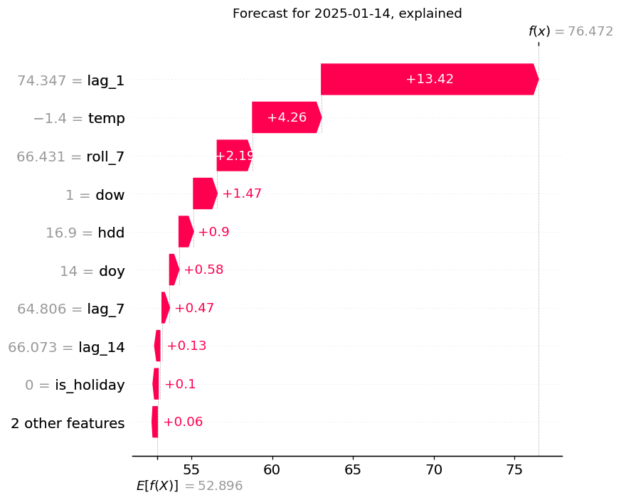
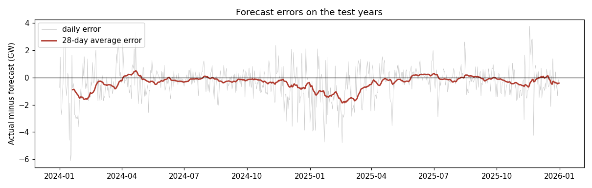

# France Power Demand Forecasting: LightGBM + SHAP

Next-day (D+1) forecast of French national electricity demand with LightGBM, tested on two full years the model never saw (2024 and 2025), and explained with SHAP.

**Result:** LightGBM forecasts tomorrow's demand with an average error of **0.89 GW (1.69% MAPE)**, against 2.30 GW for the best simple baseline: **61% lower**, and about 60% lower on each test year.

[](https://colab.research.google.com/github/rumi17Git/France-Power-Forecast-using-LightGBM/blob/main/notebook.ipynb)



## Data

- **Electricity:** RTE national consumption from the [ODRE open data platform](https://odre.opendatasoft.com/). The consolidated history (`eco2mix-national-cons-def`, up to 31 August 2026) is used wherever it exists, and the real-time dataset (`eco2mix-national-tr`) only for the days after it.
- **Weather:** daily mean temperature for Paris from the [Open-Meteo](https://open-meteo.com/) archive API.
- **Period:** 1 January 2015 to 17 November 2026, 4,339 days. Readings are averaged per day and converted to GW. No day was dropped for missing readings and no calendar day is missing.

Both sources are free, need no account, and are downloaded directly by the notebook.

## Method

- **Target:** average load on day t, in GW.
- **Features,** all known by the end of day t-1: load yesterday, one week ago and two weeks ago, the 7-day average, day of week, month, day of year, French public holidays, and temperature with heating degrees (below 15.5 °C) and cooling degrees (above 22 °C).
- **Leakage check:** features are rebuilt on data cut at day t and must match the full table exactly (passed on three test days).
- **Validation:** time-based, never random. Each fold trains on the past, uses the next year for early stopping, and is tested on the year after.

| Fold | Train | Early stopping | Test |
| --- | --- | --- | --- |
| 1 | 2015 to 2022 | 2023 | 2024 |
| 2 | 2015 to 2023 | 2024 | 2025 |

Three LightGBM versions are compared with two baselines:

- **LightGBM:** all features, L1 objective.
- **LightGBM, no weather:** without any temperature feature (ablation).
- **LightGBM, monotone:** heating degrees constrained so the forecast can never fall when it gets colder. LightGBM refuses monotone constraints with the L1 objective, so this version uses L2.

## Results

Average over the two test years (per-year figures in [`results/results.csv`](results/results.csv)):

| Model | MAE (GW) | RMSE (GW) | MAPE (%) |
| --- | --- | --- | --- |
| Naive (tomorrow = today) | 2.30 | 3.07 | 4.67 |
| Seasonal naive (same weekday last week) | 3.19 | 4.79 | 5.92 |
| **LightGBM** | **0.89** | **1.25** | **1.69** |
| LightGBM, no weather | 1.23 | 1.79 | 2.31 |
| LightGBM, monotone | 0.91 | 1.26 | 1.75 |

| MAE (GW) by test year | 2024 | 2025 |
| --- | --- | --- |
| Naive | 2.30 | 2.29 |
| LightGBM | 0.86 | 0.92 |

What this shows:

- **Temperature matters, but it is not the whole story.** Without any temperature feature the model still reaches 1.23 GW, 46% better than the naive baseline. About a quarter of LightGBM's gain over the baseline comes from temperature; the rest comes from lags, calendar and holidays.
- **The monotone rule is almost free.** Forcing "colder never means less demand" costs 0.02 GW of MAE, and makes the model's behaviour easier to trust.
- **Naive beats seasonal naive.** Weather persists from one day to the next more than demand repeats from one week to the next.

## What drives the forecast (SHAP)



Yesterday's load (`lag_1`) dominates: a high value pushes the forecast up by as much as 15 GW. Day of week comes next: weekends (high `dow`) pull the forecast down by 2 to 4 GW. Then temperature, where cold days push it up by as much as 4 GW. Public holidays pull it down by 3 to 4.5 GW.



The heating effect rises steadily and gets steeper on the coldest days. Adding up the three temperature features, each degree below 15 °C adds about **0.46 GW** to the forecast. That is much less than RTE's usual estimate of about [2.4 GW per degree in winter](https://www.connaissancedesenergies.org/approvisionnement-electrique-vigilance-et-incertitudes-cet-hiver-241104). This is expected: yesterday's load already reflects the cold, because cold days follow cold days. SHAP only credits temperature with the change on top of what the lags already show, and the model sees Paris temperature only.



On the coldest day of 2025 (14 January, -1.4 °C), the model forecast 76.5 GW against an actual 78.0 GW. Starting from the yearly average of 52.9 GW, yesterday's high load added 13.4 GW, temperature added 4.3 GW (plus 0.9 GW from heating degrees), and the 7-day average added 2.2 GW.

SHAP explains what the model does, not what causes demand in the real world. Features that move together (`lag_1` and `roll_7`, or `temp` and `hdd`) share credit, so they should be read as a group.

## Errors and drift

The ten largest errors on the test years ([`results/top_errors.csv`](results/top_errors.csv)):

| Date | Day | Actual (GW) | Forecast (GW) | Error (GW) | Temp (°C) | Note |
| --- | --- | --- | --- | --- | --- | --- |
| 2024-01-17 | Wed | 70.1 | 76.2 | -6.1 | 1.2 | Cold weekday |
| 2024-01-18 | Thu | 68.6 | 74.2 | -5.6 | -0.3 | Cold weekday |
| 2025-02-17 | Mon | 65.6 | 70.4 | -4.8 | 1.8 | Cold Monday |
| 2025-01-22 | Wed | 68.8 | 73.5 | -4.8 | 5.0 | Cold weekday |
| 2024-01-15 | Mon | 72.1 | 76.7 | -4.6 | 1.0 | Cold Monday |
| 2025-11-24 | Mon | 63.1 | 67.4 | -4.3 | 7.1 | Not identified |
| 2025-01-05 | Sun | 57.3 | 61.2 | -4.0 | 9.9 | Last day of Christmas school holidays |
| 2025-01-09 | Thu | 63.8 | 67.6 | -3.9 | 6.0 | Winter weekday |
| 2024-12-24 | Tue | 58.5 | 62.4 | -3.9 | 7.0 | Christmas Eve |
| 2025-01-06 | Mon | 60.4 | 64.3 | -3.8 | 9.4 | First school day after the holidays |



All ten are over-forecasts, and nine fall between December and February. The 28-day average error (red line) shows the same pattern: it dips below zero in both winters, by up to about 1.8 GW in early 2025, and stays close to zero the rest of the year. A likely cause is that most training winters come from before the energy savings period that started in autumn 2022, when demand reacted more strongly to cold. In a live system, an alert on this line would flag the drift.

## Limitations

- **Oracle temperature:** the model uses the real temperature of the day it forecasts, which assumes a perfect weather forecast. The no-weather result (1.23 GW) shows the other extreme; a production system would use day-ahead weather forecasts.
- **Paris temperature only,** used as a proxy for the whole country.
- **One horizon:** next day only.
- **Structural breaks:** the 2020 lockdown and the lower demand since late 2022 are in the training data but not modelled explicitly, and the winter over-forecasts above are probably linked to them.

## Next steps

- Weight recent years more, or add a post-2022 feature, and check whether the winter over-forecasts shrink.
- A population-weighted national temperature from several cities.
- D+1 to D+7 forecasts, one model per horizon.
- Prediction intervals with quantile LightGBM.
- Serve forecasts through an API with Docker and CI, as in my [CNIL RAG project](https://github.com/rumi17Git/CNIL_RAG-Compliance-Assistant-for-French-Data-Protection).

## Repository

```
notebook.ipynb      the whole pipeline, run top to bottom
figures/            the five figures used in this README
results/            results.csv (all models, both years) and top_errors.csv
requirements.txt    exact package versions used
```

## How to run

1. Open `notebook.ipynb` in Google Colab (badge above).
2. Runtime > Run all. CPU is enough; it takes a few minutes.
3. Figures are saved to `figures/`, tables to `results/`.

To run locally: `pip install -r requirements.txt`, then open the notebook in Jupyter.

## Data credits

Electricity data: RTE eCO2mix, via ODRE. Weather data: [Open-Meteo.com](https://open-meteo.com/).
